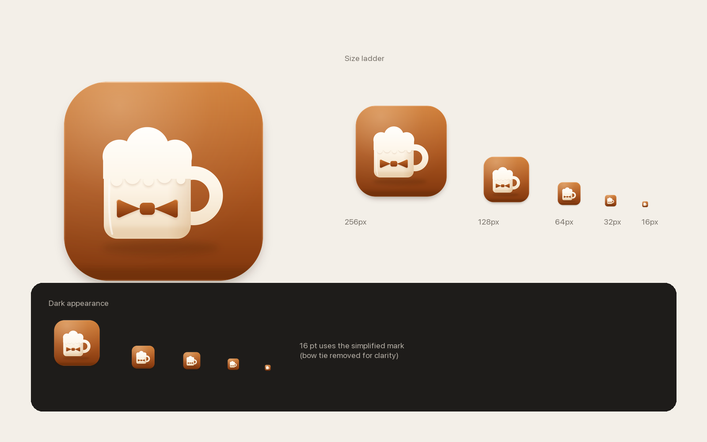

# Brewbutler 应用图标



## 概念

铜色圆角方形为底，奶油色啤酒杯为主体，杯身一枚铜色领结——**brew（啤酒）+ butler（管家）**。
杯形与菜单栏的 `mug.fill` 符号一致，铜色沿用 `AppTheme.accent`（浅色 `#A8541F`），与应用的暖纸色 UI 同源。

## 文件

| 文件 | 用途 |
| --- | --- |
| `Brewbutler-icon.svg` | 1024×1024 主稿，用于 32–1024 px 全部尺寸 |
| `Brewbutler-icon-16.svg` | 16 px 简化稿：去掉领结，小尺寸下更干净 |
| `build-icon.sh` | 渲染 10 个尺寸到 `Brewbutler/Assets.xcassets/AppIcon.appiconset/` |
| `preview.png` | 尺寸阶梯与深色背景预览 |

## 重新生成

```bash
brew install librsvg          # 仅首次
design/app-icon/build-icon.sh
```

修改 SVG 后重跑脚本即可。工程已在 Debug / Release 两个配置中设置
`ASSETCATALOG_COMPILER_APPICON_NAME = AppIcon`，Xcode 构建时会自动生成 `AppIcon.icns` 与 `Assets.car`。

## 规格

- 画布 1024×1024，主体 824×824（四周留白 100 px），圆角 185，符合 macOS 图标网格。
- 背景渐变 `#D07E37 → #AC5720 → #7F350C`；杯体 `#FFFEFB → #FDF5E8 → #EED9BA`；领结 `#C06A2A → #8A3B0F`。
- 16 px 使用简化稿；16@2x（32 px）起使用完整稿，领结仍可辨认。
- 目前为传统 appiconset（PNG + icns）。若之后要使用 macOS 26+ 的 Icon Composer 分层图标，可从本 SVG 拆层导入。

## 验证

- `xcrun actool` 编译资源目录：无警告，产出 `AppIcon.icns` / `Assets.car`。
- `xcodebuild -scheme Brewbutler build`：BUILD SUCCEEDED；产物 `Info.plist` 含
  `CFBundleIconFile = AppIcon`、`CFBundleIconName = AppIcon`。
